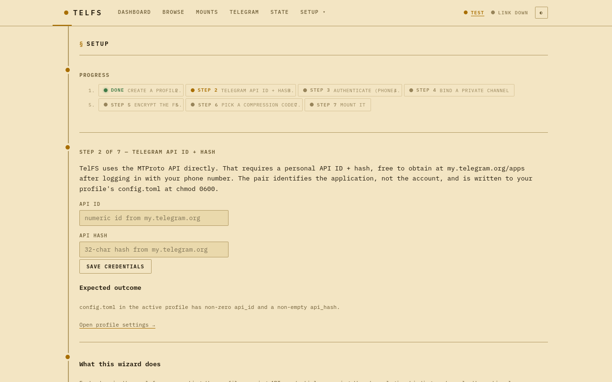

# TelFS

[](https://github.com/platonic-realm/TelFS/actions/workflows/ci.yml)
[](https://github.com/platonic-realm/TelFS/releases)
[](LICENSE)

A POSIX filesystem that stores its data in a private Telegram channel.
Files are chunked, encrypted with AES-256-GCM, and uploaded as channel
messages; a local SQLite database holds the metadata, and every change
to it is posted — encrypted — to the same channel as a journal, with an
occasional whole-database snapshot, so a fresh machine with the account
and the profile's secret can mount and read every byte. On the channel
nothing is readable without the secret but message sizes and times.
Built to hold an off-site backup: it runs as a systemd service, tells a
backup job when the channel holds everything (`telfs sync --wait`),
keeps named versions and restores them in bulk. Pure-Go, single static
binary.

```sh
telfs profile create main && telfs profile use main
telfs login                                  # sets the secret; phone + code + 2FA
telfs channel set <id>
telfs init                                   # new filesystem (always encrypted)
telfs key export                             # keep this with the secret
telfs trash enable --ttl 7d                  # optional: rm safety-net
telfs mount ~/External
```

## What works today

End-to-end verified on a real Telegram account + private channel:

| Capability | Status |
|---|---|
| Login — interactive phone + code + 2FA over MTProto (one identity per profile, logout supported) | ✓ |
| Read/write mount with full POSIX: files, dirs, hardlinks, symlinks, xattrs | ✓ |
| Multi-chunk files (no per-file ceiling), cross-chunk-boundary read/write | ✓ |
| Cold-mount recovery from channel snapshot + journal replay (the journal trails by ≤5 s) | ✓ |
| Snapshots that scale (format 2): rare whole-DB snapshots, found through a pinned encrypted anchor — no history scan | ✓ v1 |
| `--readonly` mount, FLOOD_WAIT handling, persistent LRU chunk cache | ✓ |
| Service mode: `mount --service` (systemd `Type=notify`, waits for the network at boot, never prompts), example unit, secret from systemd encrypted credentials | ✓ v1 |
| Control socket per mount: `status --json`, `sync --wait`, `unmount` that waits for the daemon — no secret needed | ✓ v1 |
| Disk-backed staging queue with a byte cap: a 400 GB `rsync` slows to upload speed instead of filling the disk | ✓ v1 |
| Parallel uploads: a pool of connections to the account's data centre, a byte-rate cap | ✓ v1 |
| `telfs gc` — orphan chunks + stale snapshots (not while mounted, not with versions) | ✓ |
| `telfs fsck` — channel-side integrity check; `--quick` (format 2): every referenced message exists with its size, nothing downloaded, through the running mount | ✓ (`--quick`: v1) |
| `telfs status` / `telfs doctor` — one-screen state / local invariant lint | ✓ |
| Format 2 (new filesystems): everything encrypted — chunks, captions, snapshots, journal; sizes Padmé-padded; Argon2id over 2 GiB | ✓ |
| One secret per profile from a prompt, a secret file, or KeePassXC; encrypted `session.enc`; non-dumpable processes | ✓ |
| Key header pinned in the channel + a text export for the break-glass kit; `telfs secret change` | ✓ |
| Self-describing chunks: rebuild the metadata from captions alone (`telfs recover --from-captions`) | ✓ |
| Profiles + portable tar.gz export/import bundles | ✓ |
| Web management UI: dashboard, login wizard, mount supervisor, file browser | ✓ (`telfs web`) |
| `telfs trash` — `rm` reroutes to `/.trash`, TTL GC | ✓ |
| Snapshot history + point-in-time restore (last 12 by default) | ✓ |
| Versions (format 2): named, immutable whole-filesystem versions, each mountable read-only next to the live mount | ✓ v1 (`telfs versions`) |
| Bulk restore (format 2): each channel message downloaded once, every restored file verified by its keyed hashes, resumable | ✓ v1 (`telfs restore`) |
| Content-addressed chunk dedup, keyed hash (format 2; format 1: plaintext + convergent); small packed files are not deduplicated | ✓ |
| Space reclamation on an always-mounted filesystem, version-aware gc | ✗ later (see [Known limits](#known-limits)) |
| Multi-mounter coordination | ✗ one writer per machine is enforced; nothing stops a second machine |

Rows marked **v1** are built and unit-tested against fakes of the
channel; their live acceptance run (≈0.5 M files, ≥10 versions, a cold
recovery checked file by file, a timed restore, service boot/stop) is
still to come. The rest has run end to end on a real account. New
features need a format-2 filesystem (`telfs init`); a format-1
filesystem refuses them with a clear message (see
[Format 1](#format-1-filesystems-from-v022-and-earlier)).

## Telegram API credentials (API ID + hash)

TelFS speaks the MTProto API directly — the same protocol the official
apps use (2 GB per upload; the HTTP Bot API and its 50 MB / 20 MB
caps are never used). MTProto requires every client application to
identify itself with an **API ID + API hash** pair. You create it once
and reuse it for every profile — it identifies the *application*, not
your account.

> Bot-token auth existed briefly and was removed: MTProto requires the
> api_id/api_hash pair even for bots (`auth.importBotAuthorization`
> takes them as parameters), so a bot identity saved nothing over a
> user login while adding channel-admin requirements and an
> identity-scoped access_hash trap. Auth is phone login, full stop.

### Creating the pair (one-time, ~2 minutes)

1. Open <https://my.telegram.org> and log in with your **phone
   number** — Telegram sends the confirmation code to your Telegram
   app (not SMS).
2. Click **API development tools**.
3. If you have no app yet, fill the short form: any **App title** and
   **Short name** (e.g. `telfs`), platform **Desktop** or **Other** —
   URL can stay empty. Submit.
4. The page now shows your **App api_id** (a number, e.g. `12345678`)
   and **App api_hash** (32 hex characters). That's the pair. It stays
   retrievable on that page forever — nothing to write down urgently.

Treat the hash like a password-ish secret: it can't read your account
by itself (a login still needs your phone + code), but don't publish
it.

### Entering the pair in TelFS

**Web (recommended):** run `telfs web`, open
<http://127.0.0.1:8080/setup> and follow the wizard — every step is an
inline form on that one page: profile → API ID + hash → phone login →
channel → optional encryption/compression → first mount. The
credentials form is also on each profile's page, and the login form
collects the pair inline if it's missing.



**CLI:** either export them as environment variables before `telfs
login`:

```sh
export TELFS_API_ID=12345678 TELFS_API_HASH=0123456789abcdef0123456789abcdef
```

or put them in the active profile's config file
(`~/.config/telfs/profiles/<name>/config.toml`, mode 0600):

```toml
api_id = 12345678
api_hash = "0123456789abcdef0123456789abcdef"
```

The same pair works in every profile you'll ever create.

## Install

```sh
# Pre-built static binary (no toolchain):
curl -L https://github.com/platonic-realm/TelFS/releases/latest/download/telfs-$(uname -s | tr '[:upper:]' '[:lower:]')-$(uname -m).tar.gz | tar xz
sudo install telfs-*/telfs /usr/local/bin/telfs

# Build from source (Go 1.22+):
git clone https://github.com/platonic-realm/TelFS.git && cd TelFS && make build
```

Both paths produce the same static binary; `fusermount` (`fuse3` or
`fuse2`) must be in `$PATH` for unmount. Get a Telegram API ID + hash
at <https://my.telegram.org/apps>.

## Quick start (web — recommended)

One command; everything else happens in the browser:

```sh
telfs web
```

Open <http://127.0.0.1:8080> — you land on the `/setup` wizard, and
every step is an inline form on that one page:

1. **Create a profile** — it becomes active immediately.
2. **API ID + hash** — paste the pair from
   [my.telegram.org/apps](https://my.telegram.org/apps) (see
   [Telegram API credentials](#telegram-api-credentials-api-id--hash)).
3. **Secret** — where the profile's secret comes from: typed in,
   a secret file, or KeePassXC (see [Secrets](#secrets)).
4. **Phone login** — number → the code Telegram sends → 2FA if set.
   The first login sets the secret: the session is stored encrypted.
5. **Pick a channel** — your channels are listed; one click binds.
   (Create a private channel in the Telegram app first.)
6. **Create the filesystem** — chunk size and compression; always
   encrypted. Skip it if the channel already holds a TelFS
   filesystem: mounting recovers it.
7. **Mount** — type a mountpoint (existing empty dir) and hit Mount.
   You land on the mount's page with a live log.

That's it — the daemon runs detached (it survives closing `telfs
web`), your files are at the mountpoint, and the Files tab browses
them from the browser. Day-to-day driving — start/stop mounts, log
tails, Telegram traffic stats, rate limits — all lives in the same
UI. To make the console permanent, run `telfs web` as a user systemd
service (see [Running unattended](#running-unattended)).

## Quick start (CLI)

The same flow, scriptable:

```sh
# Profile = isolated FS instance at ~/.config/telfs/profiles/<name>/.
telfs profile create main && telfs profile use main

# Where the secret comes from (default: typed in). See "Secrets".
#   [secret] source = "keepassxc", entry = "Services/TelFS/main"   in config.toml

telfs login                                  # asks for the API pair if missing,
                                             # sets the secret, phone + code + 2FA
telfs channel list                           # find the channel id
telfs channel set <id>
telfs channel ping                           # smoke test

# A NEW filesystem (always encrypted). 4 MiB chunks by default; 64 KiB..1.5 GiB,
# power of two; chunk size and compression are fixed from here on.
telfs init [--chunk-size $((16*1024*1024))] [--compression zstd]
telfs key export > ~/telfs-main-key.txt      # → KeePassXC entry / break-glass kit

mkdir mnt && telfs mount ./mnt               # foreground; ^C to unmount
# background daemons: `telfs unmount <mountpoint|profile>` stops any
# telfs mount gracefully, however it was started
```

Then in another shell — write, hardlink, symlink, xattr all work:

```sh
echo hi > mnt/hello.txt && cat mnt/hello.txt
mkdir mnt/notes && mv mnt/hello.txt mnt/notes/
ln mnt/notes/hello.txt mnt/notes/alias       # hardlink
ln -s notes/hello.txt mnt/link               # symlink
setfattr -n user.tag -v important mnt/notes/hello.txt
```

On `^C` the daemon `fusermount -u`s, drains in-flight requests and
uploads, posts the last journal ops (a format-1 filesystem: snapshots
the meta DB instead), and tears down the MTProto session.

## Mount options

```
telfs mount [--readonly [--version NAME]] [--service] [--key-header FILE]
            [--allow-other] [--debug] [--no-recover] [--metrics-addr ADDR] <mountpoint>
```

`--allow-other` needs `user_allow_other` in `/etc/fuse.conf`. With it,
the kernel checks every access against the owners and modes TelFS
stores (`default_permissions`) — the same rules as on a local disk;
`--no-default-permissions` turns that off (every local user can then
read and write everything, the behaviour before v1.1). Every file
carries the uid/gid of whoever created it; the root directory belongs
to whoever ran `telfs init` (mode 0755), so other accounts may need a
one-time `chown`/`chmod` of the mount's root (as root, through the
mount).
`--debug` logs every FUSE op (very chatty). `--service` is for systemd
(see [Running unattended](#running-unattended)), `--key-header` for a
recovery without the pinned key message (see [Recovery](#recovery)).
`--no-recover` makes a mount without a local DB fail instead of
recovering it from the channel. `--metrics-addr ADDR` additionally
serves Prometheus `/metrics` (and the daemon's JSON pages) over TCP;
it is off by default — everything else talks to the
[control socket](#talking-to-a-running-mount-status-sync-unmount).
Cache and read tuning: `--cache-cap`, `--mem-cache-cap`,
`--prefetch-window`, `--prefetch-concurrency`, `--blob-prefetch`
(`telfs mount -h`).

**`--readonly` never writes to the channel** — no snapshots, no journal,
no uploads, no deletions, no pins: the Telegram session itself refuses
every channel write, and the kernel mount carries `ro`. That is the
way to run a recovery drill from another machine while the real mount
keeps running. (Local state — the restored DB, the cache — is still
written.)

**One writer per filesystem.** On one machine `telfs mount` refuses a
second mount of the same profile (two daemons would share its
database) and a read-write mount of a filesystem that is already
mounted under any profile. The mount source in `/proc/mounts` is
`telfs:<profile>:<fs_uuid>`, so every user and tool can see which
filesystem is mounted where. **Nothing yet stops a second machine**
from mounting the same channel read-write — two writers would silently
lose each other's changes. Mount read-write in one place only; drill
elsewhere with `--readonly`.

`--readonly --version NAME` mounts a [version](#versions) instead of
the live tree; it may run next to the live read-write mount of the
same profile.

## Talking to a running mount: status, sync, unmount

Every mount serves its profile's **control socket**,
`<profile>/daemon.sock`: mode 0600 inside the 0700 profile directory,
and it answers only processes of the daemon's own user. These commands
use it and need no secret — a backup or monitoring job never sees one:

```sh
telfs status --json            # one JSON object (schema 1); works mounted or not
telfs sync                     # exit 0 if the channel holds everything now, 4 if not
telfs sync --wait --timeout 6h # block until everything written before this call is on the channel
telfs unmount <mountpoint|profile>   # returns when the daemon has exited (--timeout, default 2m)
telfs versions create NAME     # see Versions
telfs fsck --quick [--json]    # every referenced message still on the channel (see Maintenance)
```

**What `sync --wait` guarantees when it returns 0:** every change made
through the mount whose call had returned (`write`/`close`/`fsync`/
`rename`, …) before `sync` was called is on the channel — its data
uploaded and its journal ops posted, including where each chunk lives —
so a cold recovery from the channel alone brings back at least that
state, file for file. It does not promise a new snapshot (recovery
replays the journal after the newest one) and says nothing about later
changes. Format 2 only. Data of a file still open for writing counts
once it is closed.

`sync --wait` without `--timeout` waits as long as it takes; with one
it exits 4 when the time is up. Without a running mount `sync` exits 5.

`telfs status --json` prints one object, **schema 1** — fields are only
ever added within it:

```json
{
  "schema": 1, "telfs_version": "v1.0.0", "profile": "backup", "fs_uuid": "…", "format": 2,
  "mounted": true, "read_only": false, "version_mount": null, "mountpoint": "/srv/telfs/backup",
  "pid": 1234, "log_path": null,
  "link": {"state": "ok", "last_success_unix": 0, "flood_wait_until_unix": 0},
  "sync": {"synced": true, "pending_uploads": 0, "pending_bytes": 0, "journal_unposted": 0,
           "oldest_pending_age_s": 0},
  "snapshot": {"last_msg_id": 0, "last_unix": 0, "journal_ops_since": 0},
  "versions": {"count": 0, "newest": {"name": "…", "created_unix": 0}},
  "upload": {"connections": 8, "rate_cap_bytes_per_s": 5000000, "rate_bytes_per_s": 0},
  "staging": {"dir": "/…/pending", "pending_bytes": 0, "cap_bytes": 50000000000, "blocked": false},
  "key_header": {"pinned_ok": true, "checked_unix": 0},
  "crypto_uses": {"chunk": 0, "meta": 0, "caption": 0, "warn": false},
  "last_error": {"text": "…", "unix": 0}
}
```

`link.state` is `ok`, `busy` (a flood wait, or uploads without progress
for a minute), `down` (not connected) or `fault` (an error in the last
30 s). `sync.synced` is the same verdict as `telfs sync`; `staging.blocked`
means writes are waiting for uploads (the staging cap or free-space floor
is reached). Without a running mount the object comes from local state:
`mounted: false`, `sync` as of the last unmount, the live-only fields
(`read_only`, `link`, `upload`, …) null; `last_error` is null when there
was none. `status --json` exits 0 mounted or not (1 only when the
profile cannot be read). `telfs status --json --version NAME` asks that
version's mount instead (`version_mount` = its name; exit 5 when it is
not mounted).

### Exit codes

The same for every command:

| Code | Meaning |
|---|---|
| 0 | ok |
| 1 | usage or other error |
| 2 | secret source unavailable (no file, no KeePassXC, `$CREDENTIALS_DIRECTORY` unset, a prompt in service mode) |
| 3 | wrong secret |
| 4 | timeout / not synced yet (`sync`, `versions create`; `restore` of data the mount had not uploaded yet) |
| 5 | not mounted — no daemon answers (`sync`, `unmount`, `versions create\|delete`, `status --json --version`) |
| 6 | Telegram or the channel unreachable or refused, after the retries the command does |
| 7 | integrity problem: `fsck` findings, a recovery refused or incomplete, a key header mismatch, restored files that do not match their keyed hashes |

## Versions

A version is a whole-filesystem snapshot kept under a name until you
delete it (format 2). It is immutable by construction: one sealed
message on the channel that nothing ever edits.

```sh
telfs versions create daily-2026-10-28 [--timeout 6h]
telfs versions list [--json]
telfs versions delete daily-2026-10-28
telfs mount --readonly --version daily-2026-10-28 /mnt/daily
telfs unmount /mnt/daily
```

- **create** talks to the running mount (no secret needed). It first
  waits exactly like `sync --wait` — everything written through the
  mount before the call reaches the channel — then uploads an encrypted
  copy of the database as the version, records it in the local
  registry and re-posts the pinned anchor with the version list. Exit
  0 once the version is on the channel; 4 when the sync did not finish
  within `--timeout` (nothing was posted); 5 without a running mount; 6
  when Telegram failed. Names: 1–64 characters of `A-Z a-z 0-9 . _ -`,
  unique (a duplicate exits 1). The database is copied only while no
  upload is in flight and checked: a version never holds a file with
  its size but without all its chunks (no journal follows a version to
  fill them in later). If writes are still landing, create syncs again
  and takes it again — up to 5 times, within `--timeout` — and then
  exits 4 naming the files, with nothing posted. Create a version once
  the writer (rsync) is done. A create stopped while it syncs (SIGTERM,
  ^C) gives its request up, so a retry of the same name is not refused;
  one that is posting finishes on the mount's side.
- **list** asks the running mount, else reads the local registry
  (read-only, no secret). `--json` prints `{"versions": [{name, msg_id,
  created_unix, seq, size, sha256, mountpoint}]}`, oldest first;
  `mountpoint` is set while that version is mounted. Retention is the
  caller's (e.g. the backup job deletes what it no longer keeps).
- **delete** goes through the running mount: the version's message,
  its registry entry and its local copy go, and the anchor is
  re-posted. Refused while the version is mounted.
- **mount --readonly --version NAME** downloads the version once into
  `<profile>/versions/NAME.sqlite` (kept and reused while it matches the
  registry's size and SHA-256), opens it immutable and serves it
  read-only, with its own cache (`NAME.cache/`, emptied when it was
  filled for another version of that name), lock and control socket. A
  version that does not decrypt or is not the database the registry
  describes exits 7 (an integrity problem: a restart would not help). It writes nothing to the channel, nor to the live
  filesystem's database, staging directory or cache, and the
  one-writer guard ignores it (its mount source ends in `:v=NAME`): it
  runs next to the live read-write mount, and never blocks the boot
  mount. It needs the profile's local database (for the current key
  header and the registry) and the secret.

After a recovery from the channel the registry comes from the anchor;
`recover --from-captions` finds the versions by their captions.
**`telfs gc` refuses on a filesystem with versions** (and when it finds
version messages the registry does not list): it only knows the live
tree, and a chunk the tree no longer uses may be one a version needs. A
version-aware reclamation comes later; until then nothing a version
references is ever deleted. Each version costs one database snapshot on
the channel (~55 MB at 0.5 M files).

## Restore

`telfs restore` copies a tree out of the filesystem — the live one or a
version — onto a local directory, much faster than reading it through
a mount when there are many small files (format 2):

```sh
telfs restore /home/arash /srv/restore/arash             # the live filesystem
telfs restore --version daily-2026-10-28 / /srv/restore  # a version, all of it
telfs restore [--workers 4] SRC DEST
```

- **SRC** is an absolute path inside the filesystem. A directory's
  *contents* become DEST's (DEST takes the directory's mode and mtime);
  a file or symlink is restored into DEST under its name. `/.trash`
  (the rm safety net) is left out of a restore of `/`; name it to
  restore it. **DEST** is a local directory (created if missing); it
  may not be inside a TelFS mount, nor hold or lie inside the profile
  directory.
- It reads where every chunk lives from **one consistent read** of the
  database (read-only; it runs beside the live mount), groups the
  chunks by channel message and downloads **each message once**: a
  pack of small files as one ranged read over the extents it needs, a
  large file's chunk as its whole document — over `--workers`
  concurrent downloads (default 4), in message order. It writes
  directories, regular files (also empty and sparse ones), symlinks,
  hard links, modes, mtimes and `user.*` xattrs; owners only when run
  as root. Nothing is written to the channel.
- **Verification:** after writing, every restored file is read back
  from DEST and each chunk's keyed content hash compared with the
  database's; every byte outside the chunks (a sparse file's holes)
  must read as zero. (Downloads are authenticated on the way in as
  well.)
- **Resumable:** run it again after an interruption or a failure — a
  file already in DEST with the right size, matching keyed hashes and
  zeros in its holes is skipped, and in a file that is partly right
  only the wrong chunks are downloaded again. A file in DEST that shares
  its inode with a name that is not one of its own hard links (an
  earlier restore of a state where the two were linked) is written anew,
  so separate files stay separate.
- It needs the secret (it decrypts on its own): a systemd unit for it
  loads the credential like the mount's.
- Exit 0 when everything was restored and verified. Otherwise every
  file that did not come back exactly is listed in
  `<profile>/restore-<time>.tsv` (kind, path, problem — never inside
  DEST, so the restored tree stays exactly the backup) and the first 20
  on stderr; the exit code says what kind of problem it was, the
  weightiest first: **7** integrity — a chunk missing from the
  database, a message gone or damaged, or a restored file whose bytes
  differ from its keyed hashes; **6** Telegram failed after the retries
  (the restore stops; run it again to resume); **4** a restore of the
  live filesystem met files the mount had not uploaded yet — decided
  per file: its uploads were open in the mount (or staged) when the
  database was read, or its size, time or chunks changed while
  restoring (`telfs sync --wait`, then restore again); a missing chunk
  of a file with neither is lost data (7), whatever else is uploading;
  **1** DEST could not be written.

## Recovery

Lose the local DB? The next `telfs mount` restores the newest snapshot
and replays the journal posted after it. Nothing that `telfs sync
--wait` had confirmed is ever lost; beyond that, the journal trails by
about 5 s, and data still waiting in the staging directory is on the
channel only once its upload lands (see [Known limits](#known-limits)).

```sh
PROFDIR=~/.config/telfs/profiles/main
rm -rf $PROFDIR/db.sqlite $PROFDIR/cache
telfs mount ~/mnt
# Local DB missing — looking for the filesystem on the channel…
# Key header opened (filesystem 0b6f…). Looking for the newest snapshot…
# Anchor (msg 912): snapshot msg=905 (journal seq 5157198, 2026-10-28T09:12:44Z)
# Replaying 597012 journal op(s) since seq 5157198…
# Mounted at /home/you/mnt. Press ^C to unmount.
```

Measured: a snapshot of 1 M files plus a journal of 597,012 ops after it
recovered in 1 min 48 s.

A channel with no TelFS filesystem is an error ("run `telfs init`") —
a filesystem is created only by `telfs init`, never implicitly. An
empty `db.sqlite` that neither `init` nor a recovery made (something
opened a missing database) is refused too, not mounted.

On a format-2 filesystem the mount reads the channel's **pinned
messages**: the key message, unlocked with the profile's secret, and
the **anchor** — a small encrypted document naming the newest snapshot
and where the journal after it starts. It downloads that snapshot and
only the journal batches posted after it; nothing scans the channel's
history, however many chunk messages it holds. (A filesystem from
before the anchor existed is recovered by scanning, as before; its
first mount with this version posts an anchor.) If the key message is
gone, recover with the export:

```sh
telfs mount --key-header ~/telfs-main-key.txt ./mnt   # re-posts + pins it
```

`--key-header` only applies when the local DB is missing; with a
`db.sqlite` present the mount refuses instead of ignoring it.

**Every snapshot gone?** `telfs recover --from-captions` rebuilds the
metadata from the chunk captions, the packs' encrypted indexes and any
journal batches still on the channel, and writes a per-file report of
what came back under which name. With the journal present the tree
comes back exactly; from captions alone, files come back under the name
they had when last uploaded (rsync's temporary names are mapped back),
while empty files, symlinks, extra hard-link names, deduplicated copies
and later renames are lost.

### Time travel: rolling back to a historical snapshot

Snapshots are retained on the channel (last 12 by default; the one
the anchor names is never pruned). A format-2 filesystem snapshots
rarely (see `[snapshot]` under Configuration) — between snapshots the
journal holds every change, so a restore point is a snapshot, not any
moment. Format 1 snapshots every 5 minutes (~1 h of history).

```sh
telfs snapshot list                 # MSG-ID | AGE | TS | JOURNAL-SEQ
fusermount -u ~/External            # restore refuses while mounted
telfs snapshot restore 2890         # 30-min-ago snapshot
# Saves current DB as db.sqlite.pre-restore-<unix-ts>, then replaces.
telfs mount ~/External              # files now reflect that state
```

Restore is destructive to the current DB; the pre-restore copy beside
it lets you manually roll forward again. On format 2 the restore itself
then posts a snapshot of the rolled-back state and pins the anchor
naming it, so from the moment it returns a recovery from the channel
brings back the rolled-back state. If that post fails, the restore says
so (non-zero exit), the next mount posts the snapshot at once, and until
it lands the filesystem reports "not synced" (`sync`, `status --json`:
`sync.snapshot_due`); the rolled-back journal also skips one sequence
number, so a recovery through the old anchor in that window refuses at
the gap instead of replaying the abandoned state and the new one as one.
`telfs recover --from-captions` leaves the same gap and owes the same
snapshot (the next mount takes it).

## Encryption

A new filesystem (`telfs init`, **format 2**) is always encrypted, and
nothing TelFS posts is readable without the profile's secret except
the key header (salt, Argon2id parameters, the wrapped key), message
sizes and times:

| On the channel | Format 2 |
|---|---|
| Chunk and pack bodies | AES-256-GCM, random nonce, bound to the chunk's keyed content hash; the reader re-checks the hash |
| Snapshots, journal batches | AES-256-GCM under the metadata key — names, folders, sizes never in clear |
| Captions | every caption exactly 1024 characters: `tfs2` + base64 ciphertext (identity, size, mode, mtime, path hint) |
| Document names | every document is `blob` |
| Sizes | Padmé-padded (≤ 3.1 %; a full 4 MiB chunk pays nothing) |
| Key header | one pinned text message `tfs2k …` — useless without the secret |

Keys: the secret → Argon2id (1 pass, 2 GiB — RFC 9106's first choice)
→ key-encrypting key → wraps a random 32-byte data key. Chunk, hash,
metadata and caption keys derive from the data key by HKDF, one label
each. The session (`session.enc`) has its own salt and opens with the
secret alone.

AES-GCM with random nonces allows 2^32 encryptions per key; TelFS
counts them (`telfs status`, `fsck`), warns at 2^31 and turns the
filesystem read-only at 2^32 — about 3000 first full backups of a
large home folder away.

### Secrets

One secret per profile opens the session and the filesystem key. The
`[secret]` table of `config.toml` says where it comes from — never the
secret itself:

```toml
[secret]
source = "keepassxc"             # "prompt" (default) | "file" | "keepassxc"
entry  = "Services/TelFS/main"   # path inside KeePassXC's exposed Secret Service group
# file = "/srv/services/<group>/<service>/secrets/telfs"   # for source = "file"
```

- **prompt** — typed in; `TELFS_PASSPHRASE` skips the prompt. TelFS
  removes it from its own environment at start, so no process it
  starts inherits it.
- **file** — a regular file (no symlink), giving nothing to "others",
  at most 4 KiB; one trailing newline is ignored. What boot mounts use.
  For systemd encrypted credentials (`LoadCredentialEncrypted=` in the
  unit) write `file = "${CREDENTIALS_DIRECTORY}/telfs-secret"`: TelFS
  expands only that variable, reads the secret from the unit's own
  credentials directory and nowhere else (unset → error, exit 2), and
  never copies it to disk. Run anywhere else, such a profile fails
  with a clear message — commands that only talk to the running daemon
  don't need the secret.
- **keepassxc** — `secret-tool lookup Path /<entry>` against the
  running KeePassXC (unlock or confirm in its window; 2-minute limit).

`--secret-from prompt|file|keepassxc` overrides the source for one
command. `telfs secret test` checks it (exit 0 ok, 2 source failed,
3 wrong secret). Every `telfs` process is non-dumpable: other
processes of yours cannot read its environment, memory maps or file
descriptors, and no core dump is written.

The key header is readable on the channel, so a short secret can be
guessed offline: use a KeePassXC-generated password of 32+ characters.

### Key header export

```sh
telfs key export [--out FILE]
```

prints the key header as a text block with a check line (catches a
mistyped copy). Keep it in the filesystem's KeePassXC entry and the
break-glass kit: without the secret it opens nothing; with it, it is
the whole key. `telfs status` and `telfs fsck` check that the channel's
pinned key message exists and matches; `telfs fsck --fix` repairs it.

### Changing the secret

```sh
telfs secret change --new-from-prompt | --new-file PATH | --new-entry ENTRY
```

re-wraps the data key and re-encrypts `session.enc` under the new
secret, replaces the key message and prints a new export. **No data is
re-encrypted** — the data key never changes for the life of a
filesystem. So an OLD secret together with any OLD copy of the key
header (an export, a snapshot from before the change) still opens the
filesystem: destroy old exports. The only remedy for a leaked data key
is a new filesystem and an rsync copy.

### Format 1 (filesystems from v0.22 and earlier)

Older filesystems keep working as before: optional AES-256-GCM chunks
(`aes-gcm-v1`/`v2`/`v3`) and encrypted snapshots — but the journal
reaches the channel in clear, chunk documents are named
`ino<N>-idx<M>`, and on an unencrypted one the profile's secret
protects only the Telegram session. They cannot be encrypted in place:
rsync their files into a new filesystem.

## Content-addressed chunk dedup

Format 2 hashes every chunk with a key derived from the filesystem key
(HMAC-SHA256, so equal content says nothing to anyone without it); on
format 1, plaintext and convergent-encrypted FSes use SHA-256. TelFS
consults a `chunk_blob`
forward index (`hash → tg_message_id, size`) before uploading. A hit
points the new `chunk_map` row at the existing message — no upload, no
extra channel storage. `cp file copy.bin`, intra-file duplication, and
re-uploaded archives all collapse to one channel message.

The index is a cache only; GC liveness derives from `chunk_map` alone:

- **Partial unlink is safe.** Removing one of N files referencing a
  shared chunk leaves the other N-1 rows; `gc` only deletes a message
  when no row references it.
- **Reuse is verified at runtime.** Before pointing a new row at an
  indexed message, the writer checks (in the same transaction) that
  some `chunk_map` row still references it. Stale entries (target
  reaped by an earlier `gc`) fall through to a fresh upload.

`telfs status` reports the distinct-blob count. `telfs gc` prunes
stale index entries after each channel cleanup.

**Format 2** binds each chunk to its keyed content hash, not to its
slot, so an encrypted chunk is shared between files without identical
ciphertext: dedup works on every new filesystem. Each dedup hit is also
journaled (encrypted) as a `ref`, so a rebuild without snapshots can
restore deduplicated files.

**Format 1 encryption interaction** (older filesystems). `aes-gcm-v1` /
`v2` use a random per-chunk nonce + `(ino, idx)` AAD, so identical
plaintext produces different ciphertext per slot — dedup can't apply.
Format-1 filesystems created with `--convergent` (`aes-gcm-v3`; no
longer offered for new filesystems) derive the chunk nonce as `HMAC-SHA256(DEK, label‖plaintext)[:12]`
and uses nil AAD, so identical plaintext under the same DEK produces
byte-identical ciphertext (which is what makes dedup work).

| Property | `aes-gcm-v2` (default) | `aes-gcm-v3` (`--convergent`) |
|---|---|---|
| Dedup on encrypted chunks | no | yes |
| Channel observer sees duplicate-chunk count | no | yes |
| Confirmation-of-file by observer without DEK | no | **no** (still needs DEK) |
| Tampering / replay detection (GCM tag) | yes | yes |
| Passphrase rotation | yes | yes |

Why convergent dedup is still safe: classic convergent encryption is
attackable because the key *is* `H(content)`. Here the nonce
derivation is keyed on the per-FS DEK; an observer without the DEK
cannot synthesize the ciphertext for a candidate plaintext, so
possession is not testable. The residual leak is strictly equality
detection. The standards-track equivalent is **AES-GCM-SIV** (RFC
8452); v3 is a hand-rolled thinner variant whose safety invariant is
that the HMAC input is the *full* chunk plaintext (a prefix/sample
would collapse distinct plaintexts onto the same nonce, catastrophic
for AES-GCM).

## Maintenance

```sh
telfs gc                         # dry-run: orphan chunks + stale snapshots
telfs gc --yes                   # actually delete
telfs fsck                       # check every chunk_map row against the channel
telfs fsck --fix                 # drop unreadable rows (file becomes short)
telfs fsck --quick [--json]      # format 2: existence + size only, nothing downloaded
telfs status                     # profile / channel / FS / encryption / mount
telfs doctor                     # local invariant lint (see below)
telfs trash enable --ttl 7d      # rm safety-net (see below)
```

`gc` finds **orphan chunks** (msg_ids not in `chunk_map` — left behind
by overwrites/unlinks; see Design choices) and **stale snapshots**
(beyond the retention window; never the current one nor the one the
pinned anchor names). The anchor, the key message, versions and any
message gc does not recognize are never deleted. Default is dry-run.
On a filesystem with [versions](#versions) gc refuses altogether.

`fsck` downloads and decrypts every chunk — hours on a large
filesystem. **`fsck --quick`** (format 2) downloads nothing: it asks
the channel about every message `chunk_map` references, 100 ids per
request (~1 k requests for 0.5 M files), and checks that each one still
exists with its document and that every packed extent fits inside its
document (`pack_offset + pack_size` ≤ the document's size). With a
running mount it goes through the daemon's control socket and needs no
secret (a monitoring unit can run it); without one it opens its own
read-only session, which needs the secret. Exit 0 when everything is
there; 7 when a message is missing (deleted, or without a document) or
too small — the first 20 on stderr, each with how many chunk rows use it
and one file that does; 6 when Telegram or the channel could not be
read. `--json` prints one object: `{messages_checked, rows_checked,
missing: [{msg_id, rows, example_path, example_ino, reason}], too_small:
[{msg_id, rows, example_path, example_ino, doc_size, need}], took_s}`,
every finding included. It checks the live filesystem's references (not
those of versions; nothing a version references is ever deleted in v1),
and says nothing about the content: a message that is there but damaged
is the full `fsck`'s (or `restore`'s) to find.

### `telfs trash` — rm safety-net

```sh
telfs trash enable --ttl 7d      # turn on, retain 7 days
telfs trash status               # state, ttl, count
telfs trash list                 # oldest first
telfs trash empty                # purge now
telfs trash disable
```

Every kernel-issued `unlink`/`rmdir` reroutes into `/.trash/`; a
background GC actually deletes entries older than the TTL. The trash
settings (like the `telfs ratelimit` pins) live only in the local DB,
not in the journal: on format 2 a change marks a snapshot owed, which
the daemon takes within a minute (or the next mount at once), and the
filesystem is not synced until it is on the channel. Restore is
just `mv /.trash/<unix-nano>-orig /restored` — the trashed dirent
points at the same inode, so file content is untouched. Notes: unlinks
*inside* `/.trash` actually delete; `rm /.trash` itself returns EPERM;
`rm -rf foo/bar/` flattens — each file lands as a sibling in
`/.trash`, restorable individually but not as a preserved tree.

### `telfs doctor` — local invariant lint

```sh
telfs doctor                     # exit 0 on clean / warnings, 1 on errors
```

Read-only complement to `status` (state) and `fsck` (channel side).
Checks `config.toml` / `session.enc` permissions (warns above 0600; flags a plaintext v0.22 `session.json`),
`meta_kv` invariants (valid UUID, chunk_size power-of-two, crypto KV
consistent), `chunk_map` health (positive sizes/msg_ids, dedup ratio),
cache vs `chunk_map` (orphan cache files), snapshot + journal
high-water markers. Findings are graded `ok` / `info` / `warn` / `err`
and the exit code reflects any `err`, so it's usable as a periodic
health probe.

## Configuration

Active profile's `config.toml` at `~/.config/telfs/profiles/<name>/`,
mode 0600 (don't commit it):

```toml
api_id = 12345678
api_hash = "..."
phone = "+15551234567"        # optional — prompted if missing
dc = 1                        # starting datacenter; default 2

[identity]                    # written automatically on login
user_id = 123456789
username = "you"

[channel]
id = 1234567890
access_hash = -9876543210123456789
title = "My TelFS"

[staging]                     # written through the mount, not yet uploaded
dir = "/srv/telfs-staging"    # default <profile>/cache/pending — persistent storage, not tmpfs
max_bytes = "50GB"            # above this, writes wait for uploads (default 50 GB; "0" = no cap)
min_free = "5GiB"             # never fill the staging filesystem below this (default 5 GiB)

[snapshot]                    # format 2: when to take a whole-DB snapshot
every_ops = 500000            # after this many journal ops since the last one (default 500000)
every = "24h"                 # or after this long, if anything changed (default 24h; Go duration)

[upload]                      # how chunks, packs, journal batches and snapshots go up
connections = 8               # upload connections to the account's data centre (default 8; 0 = the main connection only; max 32)
parts_per_upload = 2          # 512 KiB parts of one upload in flight at once (default 2; 1..16)
max_rate = "5MB/s"            # byte-rate cap on upload parts (default 5 MB/s; "0" = no cap; at least 64KiB/s)

[read]
offline_timeout = "60s"       # a read of uncached data that makes no progress this long fails with EIO (default 60s; "0" = wait)
```

**Reads while Telegram is unreachable.** Listing, `stat` and reading
cached data never touch Telegram. A read of data that is not cached
does; while Telegram is unreachable it fails with an I/O error once it
has made no progress — no connection, no bytes — for `offline_timeout`
(it used to wait for as long as the outage lasted). A slow download
that still moves is never cut off. `telfs restore` uses the same limit
(it then exits 6 and a re-run resumes).

**Uploads.** Telegram keeps an account's files in one data centre, often
far away (S9's account: DC5, ~170 ms round trip), and one TCP connection
that far carries ~0.2 MB/s however many parts are in flight on it. So
uploads go through a pool of `connections` extra connections to that
data centre, each upload with `parts_per_upload` parts in flight; the
up to four uploads running at once fill the pool. Measured 2026-10-28:
1 connection 0.21 MB/s, 2 parts × 8 connections 4.15 MB/s. `max_rate`
keeps TelFS from taking the whole line (a token bucket in bytes per
second over every upload part, all connections together). The adaptive
requests-per-minute limiter (`telfs ratelimit`) still applies on top: it
starts each mount at 120 requests/min (~1 MB/s of 512 KiB parts) and,
after 5 minutes without a flood wait, rises by 30 every 30 s while
uploads run (up to 1200); `telfs ratelimit mode manual` turns it off.
The defaults come from those measurements and may still change. The
mount prints the settings in effect (`Upload: 8 connections, …`);
`telfs status --json` reports them in `upload` (`connections`,
`rate_cap_bytes_per_s`) next to the measured `rate_bytes_per_s`.
Telegram answers too fast an account with `FLOOD_WAIT_X` or — its
upload limit for accounts without Premium — `FLOOD_PREMIUM_WAIT_X`;
TelFS waits the X seconds and goes on, and names each wait in the log
(`[flood-wait] …: FLOOD_PREMIUM_WAIT — …`). Repeated premium waits mean
the rate is above what the account is allowed: lower `max_rate` or
`connections`. When connections cannot be made (network cut, firewall,
out of file descriptors) TelFS spaces its attempts out — 0.2 s after a
failure, doubling to 5 s, until a server answers — instead of redialing
in a loop; and when no upload connection has answered a part for 2
minutes, uploads go over the main connection for a while (1 min,
doubling to 10 min while that repeats; the log says so).

**Snapshots (format 2).** The journal holds every change, including
where each chunk lives, so the newest snapshot plus the journal after it
is the whole filesystem; a snapshot only shortens a recovery's replay.
The mount takes one when the journal has grown by `every_ops` since the
last, or `every` has passed and something changed — at a quiet moment
(nothing left to upload), waiting at most an hour for one. Nothing at
mount when nothing changed, nothing when the upload queue drains,
nothing at unmount. After each snapshot it pins a new **anchor** naming
it (the previous anchor is deleted), so a recovery finds it without
scanning the channel. The channel therefore carries two pinned
messages: the key message and the anchor. At ~500,000 files a snapshot
is roughly 55 MB.

**Staging.** A write goes to the staging directory first and to the
channel later, so `close()` returns at disk speed. Until a chunk is
uploaded its staged copy is the only one: put the directory on
persistent storage. When `max_bytes` are waiting, writes block until
uploads catch up (a 400 GB `rsync` slows to upload speed instead of
filling the disk); if the filesystem would drop below `min_free` with
nothing of TelFS's left to upload, writes fail with "No space left on
device". A failed upload is retried from the staged copy until it
lands; anything still staged at unmount is uploaded at the next mount.
`fsync(2)` returns once the file's data is durable in the staging
directory (staged copies, the directory and the size fsynced) — it never
waits for Telegram; `telfs sync --wait` is the way to wait for the
channel. A file deleted while its chunks wait is not uploaded.

Environment overrides:

| Var | Effect |
|---|---|
| `TELFS_PROFILE` | active profile (beats `~/.config/telfs/active`) |
| `TELFS_API_ID` / `TELFS_API_HASH` | override config |
| `TELFS_PHONE` | skip phone prompt at login |
| `TELFS_DC` | override starting datacenter |
| `TELFS_PASSPHRASE` | the secret of a prompt-source profile (skips the prompt); removed from TelFS's environment at start, never inherited by a child |

## Design choices

| What | Choice | Why |
|---|---|---|
| Language | Go (`hanwen/go-fuse` + `gotd/td` + `modernc.org/sqlite`) | Pure-Go SQLite — no cgo, fully-static binary. |
| Telegram API | MTProto via `gotd/td`, user auth only | One data-plane path; 2 GB per upload. HTTP Bot API never used. |
| Metadata | Local SQLite + channel snapshots + a journal of every change | Fast reads; recovery = newest snapshot + the journal after it. |
| Chunk size | 4 MiB default, per-FS configurable via `telfs init --chunk-size`; immutable after first chunk; power of two ∈ [64 KiB, 1.5 GiB] | Throughput vs `chunk_map` row count. |
| POSIX surface | files, dirs, symlinks, hardlinks, xattrs (`user.*`) | Enough for typical workloads. |
| Encryption | Format 2: always on — AES-256-GCM, Argon2id 2 GiB, HKDF subkeys, Padmé padding, encrypted captions/journal | Nothing on the channel but the key header, sizes and times. Format 1 (old): opt-in, journal in clear. |
| Inline TG deletes | None for chunks; snapshot delete supersedes prior | Never destroys data inline; `gc` reclaims; trash layers on top. |
| Snapshot / journal cadence | Format 2: snapshot per 500,000 journal ops or 24 h, found through a pinned anchor; format 1: every 5 min + clean unmount. Journal poster every 5 s | Bounded recovery window without re-uploading the whole DB all day. |

## Profiles + portable bundles

A profile is a named dir under `~/.config/telfs/profiles/<name>/`
holding one FS's full local state (config + session + db + cache).
Multiple profiles coexist independently.

```sh
telfs profile create work
TELFS_PROFILE=work telfs login
TELFS_PROFILE=work telfs channel set <id>
telfs profile use work                      # sticky default
telfs profile list                          # shows active marker

telfs profile export bundle.tar.gz          # session.enc + config + db
telfs profile import --profile work2 bundle.tar.gz
```

A bundle holds the encrypted session (`session.enc`; a plaintext
v0.22 `session.json` is never exported), the config (only the
*location* of the secret) and the DB (with the wrapped key). Without
the secret it opens nothing — but keep it private all the same.

- **Same-machine roundtrip is verified.**
- **Cross-device use is the design intent but unverified.** Telegram
  may flag/invalidate a session reused from a different
  device/IP; the workaround on auth failure at the destination is to
  redo `telfs login` there. The bundle's `config.toml` and `db.sqlite`
  still apply.

## Web management UI

`telfs web` boots a self-contained HTTP UI covering the entire CLI:
dashboard, profile CRUD + export/import, multi-step phone login with
logout, one-click channel binding, encryption init, mount supervisor
with HTMX-polled log tail, lifetime Telegram stats (persisted in the
profile's SQLite, visible even while the daemon is down), and a file
browser through a chosen mountpoint.

The masthead carries two lamps for the active profile, read from its
mount's control socket: **link** (ok / busy / down / fault; it turns
yellow when the staging directory holds more than 80 % of its cap and
red, "backlog", when writes are waiting for uploads — a large backlog
below the cap is normal during a first backup) and **sync** (green when
the channel alone could recover the filesystem). The Telegram tab shows
the upload queue, including the staging directory, its bytes and cap.

First-time users land on a guided `/setup` wizard where every step is
an inline form on one page: create profile → API creds → phone login
(code + 2FA inline) → pick a channel from your dialog list → optional
encryption/compression → first mount. State is derived from the
filesystem on every page load — there's no separate wizard progress
file to drift.

```sh
telfs web                                       # 127.0.0.1:8080, no auth
telfs web --listen 0.0.0.0:8080 --token $(openssl rand -hex 32)
```

Loopback bind requires no auth (perimeter = "can reach loopback").
Non-loopback bind **requires** `--token`; the server refuses to start
otherwise. Token check via `crypto/subtle.ConstantTimeCompare`; every
POST form carries a per-session CSRF token. For HTTPS, terminate TLS
in a reverse proxy in front of localhost (`--tls-cert` / `--tls-key`
exist but aren't the recommended path).

## Deployment

**Static binary**: `make release` →
`dist/telfs-vX.Y.Z-linux-amd64.tar.gz`. Built with `CGO_ENABLED=0
-trimpath -ldflags '-s -w'`; copies to any Linux host (needs only
kernel FUSE + `fusermount`). Container images were dropped for now —
FUSE-in-Docker needs `SYS_ADMIN` + `/dev/fuse` + `rshared` bind
propagation, which is more ceremony than the static binary deserves.

## Running unattended

`telfs mount` is a foreground daemon. Backgrounding with `&` in a
shell is fine for testing — but if that shell exits abruptly, the
kernel mount may stay in `/proc/mounts` while writes silently fall
through to the *local* filesystem underneath. Files dropped during
that window land on disk locally, not in the channel.

For production, run it as a service: `telfs mount --service`

- never prompts — a prompt-source profile exits 2 at once; the secret
  comes from a file or systemd's encrypted credentials (see
  [Secrets](#secrets));
- waits while the network or Telegram is unreachable at boot: recovery
  and the channel-access check are retried (5 s doubling to 5 min) on
  network errors, timeouts and Telegram server errors only, and systemd
  is told why (`STATUS=`) and asked for more time
  (`EXTEND_TIMEOUT_USEC`) so a boot without network waits instead of
  being killed; a refusal ends the service (exit 6), a refused recovery
  too (exit 7);
- reports `READY=1` once the filesystem is mounted and its control
  socket answers, `STOPPING=1` on stop;
- stops cleanly on SIGTERM: lets the uploads under way finish (up to
  12 s), posts the journal (up to 10 s) and exits 0; whatever is still
  staged stays on disk and is uploaded at the next start (run `telfs
  sync --wait` first when the channel must hold everything).

An example unit is
[`contrib/systemd/telfs@.service`](contrib/systemd/telfs@.service)
(an example — the real unit belongs to the deployment):

```ini
[Service]
Type=notify
Environment=TELFS_PROFILE=%i
LoadCredentialEncrypted=telfs-secret:/etc/credstore.encrypted/telfs-%i
ExecStart=/usr/local/bin/telfs mount --service /srv/telfs/%i
TimeoutStopSec=90
Restart=on-failure
RestartPreventExitStatus=2 3 6 7
```

with the profile's `[secret] file = "${CREDENTIALS_DIRECTORY}/telfs-secret"`;
no restart loop on the [exit codes](#exit-codes) that need a human (2, 3,
6, 7). Several profiles can be mounted at once: each has its own control
socket. Other jobs talk to the mount without the secret:

```sh
telfs sync --wait --timeout 6h && echo "the channel holds this backup"
telfs status --json | jq .sync
```

For interactive use, at minimum: `nohup telfs mount ~/External &` —
and verify the daemon survives a shell exit before trusting it with
data.

## Known limits

- **One read-write mounter per channel.** Enforced on one machine (see
  [Mount options](#mount-options)); **nothing stops a second machine**
  from mounting the same channel read-write — across machines it is
  your discipline until a channel-side writer lease exists. Drill
  elsewhere with `--readonly`.
- **Nothing is reclaimed while mounted, nor with versions.** `telfs gc`
  refuses while the filesystem is mounted and on a filesystem with
  versions; v1 has no version-aware reclamation. An always-mounted
  filesystem with versions therefore only grows on the channel:
  overwritten and deleted data, old snapshots and posted journal
  batches all stay. Nothing a version references can ever be deleted.
- **Small files are not deduplicated.** Chunks under 256 KiB go into
  packs, and packs are not in the dedup index: two identical small
  files are both uploaded (a small chunk can only reuse a large file's
  identical chunk). There are no explicit reference counts — a message
  is referenced by its `chunk_map` rows.
- **A snapshot is one document.** Format 2 uploads the whole database
  as a snapshot (~100 B per file sealed: 107 MB for 1 M files), and a
  Telegram document holds at most 2 GiB — roughly 20 M files. Snapshots
  are rare (see [Configuration](#configuration)), so that is the ceiling,
  not the cost.
- **Staged data is durable only once fsynced.** A write is on the
  channel only once its staged copy is uploaded. `fsync(2)` makes the
  staged copies, the staging directory and the file's size durable on
  this machine and returns — it does not wait for Telegram (v1.1); the
  uploads follow, also after a crash. Data written but never fsynced
  can be lost in a power cut: the mount's crash repair then cuts the
  files back to what reached the channel or the disk and says which
  (`<profile>/repair-<time>.tsv`). `telfs sync --wait` tells you when
  the channel alone holds everything.
- **Versions are read through their own mount** (`mount --readonly
  --version NAME`), not under a directory of the live mount; their
  retention is the caller's (`versions list` / `delete`).
- **Format 1 gets none of the v1 features.** Filesystems from v0.22 and
  earlier keep working as they did (journal in clear, a snapshot every
  5 minutes, no chunk placements in the journal), and `sync`, `versions`,
  `restore` and `fsck --quick` refuse them. Move the data with `rsync`
  into a new filesystem.
- **Recovery window.** A background journal poster drains the local
  `journal` table every 5 s and posts the pending ops to the channel,
  but a file's data reaches the channel only when its staged upload
  lands — during a large first backup, hours later. `telfs sync --wait`
  marks the point where nothing is missing. Recovery restores the
  latest snapshot, then replays the journal ops after it. Format 2
  journals every change, including attributes, xattrs and where each
  chunk was uploaded, so the latest snapshot plus the journal is the
  whole filesystem. Format 1 journals only the namespace (`create`,
  `link`, `unlink`, `rename`, `setsize`): there, files uploaded after
  the latest snapshot come back without their content.
- **A recovery never empties files.** If a file comes back from the
  channel with a size but without all its chunks, the mount refuses,
  lists the files (`<profile>/recovery-incomplete-<time>.tsv`) and keeps
  nothing of that recovery; `telfs recover --from-captions` then
  rebuilds the chunk placements from the captions. The crash repair of
  a normal mount still cuts a file back to what reached the channel,
  and says so: count, paths, and `<profile>/repair-<time>.tsv`.
- **Encryption metadata leakage is bounded, not zero.** On format 2 the
  number of messages, their Padmé-padded sizes and their times remain
  visible (so does the upload rhythm); on format 1 also chunk counts per
  file and the journal itself.
- **One channel = one TelFS.** `fs_uuid` is stored in `meta_kv` and
  baked into every snapshot caption; recovery filters by it, so
  reusing a channel for a fresh instance leaves old snapshots as
  garbage until `telfs gc` reaps them.
- **gotd default DC 2 may be firewalled.** If `telfs login` hangs at
  handshake, try `dc = 1` in `config.toml` (or `TELFS_DC=1`).
- **Trash is flat.** `rm -rf foo/bar/` lands as N siblings under
  `/.trash`, restorable individually but not as a preserved tree —
  fine for typo-undo, use snapshots for archival.

## Roadmap

After v1:

- **Reclamation inside the daemon** — a version-aware gc that frees
  chunks no live file and no version references, prunes old journal
  batches, and runs on an always-mounted filesystem.
- **Dedup of packed small files** and explicit reference counts.
- **`/.versions/<name>/`** inside the live mount, and retention rules
  (keep daily/weekly/monthly) inside TelFS.
- **Incremental snapshots** — no whole-database upload, no 2 GiB ceiling;
  needed only far beyond 10 M files.
- **A writer lease on the channel**, so a second machine cannot mount
  read-write.
- **Upload defaults** finalised from measurements, and the adaptive
  limiter's slow start revisited.
- **The web console for the v1 parts** (versions, restore, sync).
- Reproducible `telfs bench` for chunker/cache/upload regression
  detection.
- Better error UX in the web UI on failed login / network errors.

See [issues](https://github.com/platonic-realm/TelFS/issues) for
current state.

## Architecture

See the [academy](academy/README.md) — chapter by chapter, from the
module layout, the SQLite schema and the chunk pipeline to the channel
format ([17](academy/17-format2-security-base.md)) and the v1 work
([18](academy/18-v1-backup-service.md)).

## License

MIT — see [`LICENSE`](LICENSE).
